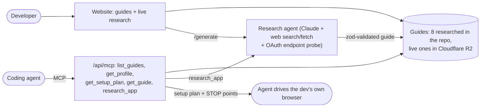

# OAuth Readiness

**How long it really takes to get an OAuth app approved with each provider, what it needs, what can block it, and an agent that sets
it up for you.** Built for developers whose AI agent has to connect to Gmail, Slack, HubSpot, Meta and the rest.

**Live:** https://oauth-readiness-five.vercel.app · **MCP:** `https://oauth-readiness-five.vercel.app/api/mcp` · **For agents:** [`/llms.txt`](https://oauth-readiness-five.vercel.app/llms.txt)

## Try it in two minutes

**1. Read a guide.** Open [Google (Search Console, GA4, Business Profile)](https://oauth-readiness-five.vercel.app/guides/google-search-analytics).
The top shows two numbers, **first token** (your own account works: 30 min) and **real users** (after Google's review: 1-3 weeks). Below
that are the steps, each marked *Agent*, *Agent drafts, you submit* or *You*. Every claim is tagged `tested`, `sourced` or `inferred`,
and links to its source.

**2. Let your coding agent set it up.** Connect the MCP server:

```sh
claude mcp add --transport http oauth-readiness https://oauth-readiness-five.vercel.app/api/mcp
```

(Cursor, VS Code, Codex and Windsurf snippets are on the [site](https://oauth-readiness-five.vercel.app/#agent).) Then ask:

> Set up the Slack OAuth app for this project with the oauth-readiness MCP. Fill the profile from this repo, ask me for anything
> missing, and walk me through it in my browser.

The agent calls `get_profile {template: true}`, fills the profile from your repo, then calls `get_setup_plan {slug, profile}`. What it
gets back (real output for a made-up "Acme Assistant", trimmed):

```jsonc
{
  "app": "Slack (Slack app, OAuth v2)",
  "steps": [
    { "n": 1, "title": "Have the agent write the app manifest", "who": "agent",
      "action": "DO: the agent can complete this step.",
      "fields": [
        { "label": "display_information.name", "value": "Acme Assistant", "status": "filled" },
        { "label": "display_information.description", "value": null, "status": "missing" },
        { "label": "oauth_config.redirect_urls", "value": ["https://app.acme.example/api/oauth/slack/callback"], "status": "filled" } ] },
    { "n": 2, "title": "Create the app from the manifest", "who": "you",
      "action": "STOP: a human must do this step (sign-in, legal, payment or judgement). Notify them and wait." }
    // ... 6 steps in all
  ],
  "missing": ["display_information.description (step 1, profile key appDescription)", "..."],
  "scopes": ["chat:write (basic)", "chat:write.public (basic)", "channels:read (basic)"],
  "credentials": { "env": { "SLACK_CLIENT_ID": "...", "SLACK_CLIENT_SECRET": "the human copies it into .env.local; never into chat" } },
  "verify": "Done when the developer's own account completes the OAuth flow ... and one API call with the token succeeds."
}
```

The agent fills forms in **your** signed-in browser and stops wherever a human has to act: sign-in, accepting terms, paying, the final
Create/Submit, and handling the client secret. This flow set up a real Google OAuth app for Iskaria end to end
([details below](#what-i-tested-sourced-or-could-not-verify)).

**3. Research a provider that isn't listed.** Type it on the home page, or open
[`/generate?q=calendly`](https://oauth-readiness-five.vercel.app/generate?q=calendly). Calendly already has a guide, so it opens at
once; a new app takes 2-4 minutes and you watch every search, fetch and endpoint probe as it happens.

## How it fits together



## Where things live

| Path | What |
|---|---|
| `src/lib/guide.ts` | The `Guide` schema (zod). Seeds, the live agent, the pages and the MCP all share it. Every claim carries `evidence` |
| `src/data/guides/*.json` | The 8 researched guides. `node scripts/validate.ts` checks the schema, source ids and profile-neutral wording |
| `src/lib/agent.ts`, `src/lib/probe.ts` | Live research agent (research, then structured compose) and the credential-free OAuth endpoint probe |
| `src/lib/plan.ts`, `src/lib/profile.ts` | A guide plus a developer profile turned into a browser-agent setup plan (fields, STOP points, missing items, env names, verify) |
| `src/app/api/mcp/route.ts` | MCP server (Streamable HTTP, no auth) |
| `src/lib/install.ts` | Install snippets per client, the agent prompt, `/llms.txt` |
| `src/lib/store.ts`, `src/lib/r2.ts` | Storage: seeds from disk, live guides in a private R2 bucket (S3 API, SigV4, no SDK), local `.data/` in dev |
| `src/app/` | Pages: home, `/guides/[slug]`, `/generate`, `/method` (all evidence in one place), `/profile` |
| `scripts/` | `validate.ts`, `probe.ts`, `setup-github.ts` (GitHub App Manifest flow), `push-live.ts` |
| `docs/research-brief.md` | The brief the research agents followed |

## The problem, as I understood it

An agent that acts in a user's Gmail, Slack or HubSpot needs a **provider OAuth app**: a client registered with the provider (client id
and secret, redirect URIs, consent screen, scopes). The developer registers it once; each end user then "connects" by consenting to that
app. Managed-OAuth platforms lend you their pre-approved app, but they don't cover every provider, and teams that want their own brand on
the consent screen, their own rate limits or extra scopes have to register their own.

Registering is quick. The hard part is the **gap between "works for my account" and "works for any user"**: Google's verification
and its paid CASA assessment, Meta's App Review and Business Verification, Microsoft's publisher verification and admin consent, LinkedIn's
partner gate, Slack's Marketplace rate limits. That gap is undocumented, spread over many pages, and it changes. So every guide leads with
two numbers: **first token** (hands-on time to your own working connection) and **real users** (calendar time including review).

## What's here

- **Library**: 8 guides chosen to cover the range of setup difficulty: GitHub (easy, no review), Slack and HubSpot (easy to start, review
  only to lift a cap), Microsoft Graph (publisher verification plus per-tenant admin consent), Google Search Console/GA4 and Gmail
  (sensitive vs restricted scopes, CASA), Meta (App Review, Business Verification, Tech Provider), and LinkedIn (gated: partner approval).
- **Live generation** (`/generate?q=<app>`): a Claude agent researches any app in 2-4 minutes, and you watch every search, fetch and probe as it
  happens. It writes a guide in the same schema at a shareable URL.
- **Evidence on every claim**: `tested` (we did it), `sourced` (an official page says so, quoted), `inferred` (third-party or reasoning).
  Every guide has a "What we checked" table, open uncertainties, and numbered sources. `/method` aggregates them.
- **Developer profile** (`src/data/profile/iskaria.json`, `/profile`): the facts registration forms keep asking for (privacy URL, domain,
  logo, support mailbox, demo video, business verification). Guides check each provider's requirements against it and flag what's
  missing: "Google needs a Limited Use section in your privacy policy; Iskaria's has none." The profile is my own company, Iskaria, a
  clinic-operations console with an AI assistant. Using a real company means the gaps are real, and we have actually set up Google and Meta
  for it.
- **MCP server** (`/api/mcp`, Streamable HTTP, no auth): the same guides for agents. `list_guides`, `get_profile` (`template: true`
  gives the keys registration forms ask for), `get_setup_plan` (a guide turned into browser-agent steps for *your* profile),
  `get_guide` (the full research) and `research_app` (runs the live agent: slow, paid, capped per day). See "Try it" above.
- **Setup agent** (`scripts/setup-github.ts`): registers a real GitHub App from the profile via GitHub's App Manifest flow. The agent does
  everything except sign-in and the final "Create" click. At each handoff it notifies you (terminal bell, phone push via ntfy, or any chat
  webhook), then receives the credentials and saves them to `.secrets/`.

## How the live agent works (`src/lib/agent.ts`)

1. **Research**: Claude Opus 5.5 with the server-side `web_search` and `web_fetch` tools, plus a custom `probe_oauth` tool that runs on our
   server (`src/lib/probe.ts`). The probe fetches the provider's `/.well-known/oauth-authorization-server` and `openid-configuration`
   (PKCE support, **dynamic client registration**) and calls the authorize endpoint with a fake client id to see how it rejects it. That is a
   real, credential-free test, and the only thing the agent can mark `tested`. The agent re-checks its 2-4 most decision-relevant claims against a
   second page and writes a dossier.
2. **Compose**: a second call with structured outputs constrained to the zod `Guide` schema (`src/lib/guide.ts`). It only uses facts and URLs
   from the dossier; dangling source ids are dropped.
3. **Save**: one JSON file per guide in a private Cloudflare R2 bucket in production (free tier; Vercel Blob's free plan blocked the store at quota), `.data/` locally. Seeded guides live in the repo.

The seeded guides were written the same way, by parallel research agents following `docs/research-brief.md`, then checked by a separate
verifier agent that was given the guides but not my conclusions.

## Key decisions

- **Guides first, automation second.** Every provider console sits behind a login, often 2FA or CAPTCHA, and some terms forbid automation.
  An agent can always research and draft; it can only sometimes click. So automation is real for GitHub (where the manifest flow makes it
  clean and allowed), and every other guide splits steps into **Agent**, **Agent drafts, you submit**, and **You**.
- **Two timelines, not one difficulty score.** "Hard" means nothing to a developer planning a launch. "30 min to first token, 4-10 weeks to
  real users, unless you only request gmail.send" is something they can plan around.
- **Personalised to a profile.** The most common approval blockers are missing assets (policy sections, demo video, verified domain,
  business verification), not code. Checking them against a profile turns generic docs into a to-do list.
- **Evidence labels instead of confidence scores.** Review wait times are almost never documented officially. Saying so beats
  inventing a precise number.
- **The probe as the agent's own setup attempt.** It can't create apps without credentials, but it can verify endpoints, PKCE and dynamic
  client registration live. That surfaced one thing documentation-reading misses: some providers' MCP servers (e.g. `mcp.notion.com`)
  support dynamic client registration, so an agent there may not need a registered app at all.

## What I tested, sourced, or could not verify

- **Tested ourselves (Iskaria, Oct 2026):**
  - **Google, end to end through the MCP (2026-10-30):** Claude Code fetched `get_setup_plan("google-search-analytics")` from
    this site's MCP endpoint and filled Google Auth Platform in the owner's signed-in Chrome (Claude in Chrome):
    - Branding (from the profile), test users, Data Access scopes, and a Web client with the profile's redirect URIs.
    - It stopped at each Save / Create and sent a desktop notification; the owner clicked them and downloaded the one-time client secret.
    - Then "Connect Google" in Iskaria's console ran the PKCE flow with a test user and read live data: Business Profile accounts
      and both clinic locations, 5 Search Console sites, and 3 GA4 properties.
    - What the console taught us, now in the guide: `webmasters.readonly` and `business.manage` are non-sensitive, so only
      `analytics.readonly` needs verification; the support email must be your own account or a Google Group; there's a new
      "AI-powered agent" client type; unsaved console forms are lost on navigation (the agent lost one and refilled it), and a "saved" Branding page had kept only the domain, which surfaced only when Publish stayed disabled. Setup plans now tell the agent to reload and read values back after every save.
  - **Google:** a Testing-mode consent screen with our own client. Refresh tokens expired after 7 days. gcloud's built-in client is blocked for Analytics/Search Console scopes. The Business Profile API needed its own access request.
  - **Meta:** the live app holds messaging scopes but lacks publishing scopes, and publish calls fail with Graph error codes 10/200-299 until Advanced Access is granted. Embedded Signup won't run on localhost.
- **Endpoint probes:** discovery and authorize behaviour for Google, Microsoft, GitHub, Slack, LinkedIn and Notion (see each guide's sources).
- **Corrected during research** (each guide's "What we checked"; summary at `/method`). Examples:
  - **Microsoft:** the 2025 managed consent policy blocks ordinary users from consenting to Mail.Read.
  - **HubSpot:** new legacy public apps can no longer be created (June 2026).
  - **Slack:** commercially distributed apps that aren't on the Marketplace get `conversations.history` at 1 request/min.
  - **LinkedIn:** the Community Management API needs its own app with no other products.
  - **Google:** Gmail `metadata`/`compose` scopes are restricted, not sensitive.
- **Independent verification pass:** a separate agent re-checked 23 high-stakes claims against primary sources: 17 confirmed,
  4 corrected, 2 unverified.
  - **GitHub:** repo-admin installs are also blocked by the Repository administration permission, and org owners can switch them off.
  - **Google:** brand verification is usually minutes when the automated check passes; 2-3 business days only on manual review.
  - **LinkedIn:** every app approved for the Marketing Developer Platform gets 365-day refresh tokens, not just partners.
- **Not verified:**
  - Real review wait times. These are community reports, labelled `inferred`.
  - Google CASA prices. Taken from assessor price lists, which change.
  - Whether Slack's 2026 throttling applies to existing installs.

## Run it

```sh
npm install
cp .env.example .env.local      # add ANTHROPIC_API_KEY (the R2_* storage env comes from `vercel env pull`)
npm run dev                     # http://localhost:3000
node scripts/validate.ts        # check all guides against the schema
node scripts/probe.ts accounts.google.com --authorize https://accounts.google.com/o/oauth2/v2/auth
node scripts/setup-github.ts --dry-run   # print the GitHub App manifest built from the profile
node scripts/setup-github.ts             # real run: opens Chrome, you sign in and click Create
```

Deploy: Vercel (Next.js preset). Set `ANTHROPIC_API_KEY`; create a private R2 bucket and an R2 API token with Object Read & Write on it, and set `R2_ENDPOINT`, `R2_ACCESS_KEY_ID`, `R2_SECRET_ACCESS_KEY`, `R2_BUCKET`; optionally
`DAILY_GENERATION_LIMIT` (default 40 live runs/day). The generate route needs up to 300 s (`maxDuration`).

## Limitations

- 8 guides, not 100. The schema, research brief and live agent are the scale path; the remaining 92 would be a batch run plus a human review queue.
- Live guides are unreviewed agent output, marked as such. A live run costs roughly USD 0.50-1.50 in API usage and takes 2-4 minutes.
- Guides go stale. Each records its access date; there is no automatic re-check yet (a scheduled re-run diffing verdicts would be next).
- Browser setup is proven for Google (agent-driven, owner saves) and scripted for GitHub (the manifest script was only dry-run
  tested; the live run timed out waiting for sign-in). Other consoles work the same way in principle, but each changes often.
- The website shows Iskaria's profile as the worked example. Over MCP any developer passes their own (`get_profile` with `template: true` lists the keys); the website itself has no per-visitor profile yet.
